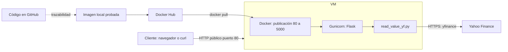

# Taller 1: servicio bursátil con Flask, Docker y AWS EC2

Implementación del taller **Despliegue de Servicios de Red**, basado en el documento `Act_7_Taller - 01 - Despliegue de Servicios v1.0.pdf`. Consulta una acción con `yfinance`, calcula el promedio de cierre del período y expone los resultados mediante HTTP.

**Estado al 10 de noviembre de 2026:** servicio local e imagen Docker construidos y verificados con datos reales de Yahoo Finance. Pasaron 24 pruebas en Python 3.10 local y las mismas 24 en Python 3.11 dentro del contenedor sin red. GitHub y Docker Hub están preparados, pendientes de autorización para publicar. El despliegue EC2 lo realizará el estudiante con acompañamiento; todavía no hay URL pública verificada.

Resultados y enlaces de entrega: [docs/EVIDENCIAS.md](docs/EVIDENCIAS.md). Guía de nube y costos: [docs/DESPLIEGUE_EC2.md](docs/DESPLIEGUE_EC2.md).

## 1. Arquitectura y relación con el PDF



Un **proceso** ejecuta instrucciones; se convierte en **servicio de red** cuando escucha un puerto y atiende solicitudes de otros procesos. Gunicorn recibe HTTP y ejecuta Flask, que reutiliza la lógica del script. El cliente de Flask es el navegador y, a su vez, el servicio actúa como cliente de Yahoo Finance: es una interacción distribuida entre máquinas.

| Sección del profesor | Implementación |
| --- | --- |
| Consulta bursátil por script | `read_value_yf.py`, función `get_stock_data(sd, stock, ed=None)` y CLI |
| Ejecución del proceso en Docker | Misma imagen, comando `python read_value_yf.py AMZN` |
| Proceso accesible con Flask | `/` muestra HTML y `/api/stock` entrega JSON |
| Exposición del puerto 5000 | Gunicorn escucha 5000; Docker publica el puerto del anfitrión |
| Publicación de imágenes | `yancertuche/stock-market:1.0`, pendiente de push autorizado |
| Ubuntu en EC2 y acceso desde Internet | Guía de despliegue por consola, todavía pendiente |

Se mantiene `test(ticker='GOOGL')` como función del ejemplo del profesor: **consulta Yahoo de verdad**, no es la suite automatizada. Se utiliza `yf.Ticker(...).history(...)` para diferenciar fallos de red, límites y ausencia de cotizaciones; conserva el objetivo y la interfaz del script original. Se fija `auto_adjust=False`, porque sus valores predeterminados han cambiado entre versiones de yfinance. Gunicorn sustituye al servidor de desarrollo del ejemplo para el despliegue.

## 2. Archivos

```text
app.py                     # Rutas HTTP y errores
read_value_yf.py            # Consulta, validación, promedio y CLI
requirements.txt           # Versiones directas
requirements.lock          # Versiones directas y transitivas probadas
gunicorn.conf.py           # Dos procesos, puerto 5000, logs y timeouts
Dockerfile                 # Python 3.11 slim y usuario sin root
.dockerignore              # Solo incluye los archivos necesarios para ejecutar
.gitignore                 # Excluye entornos, credenciales y claves
templates/index.html       # Formulario y tabla del taller
tests/                     # Pruebas sin Yahoo Finance
scripts/verify_http.py     # Verificación HTTP real y reporte JSON
deploy/ec2-bootstrap.sh    # Instalación/ejecución opcional en EC2 autorizado
docs/                      # Guía, evidencias y estado real de entrega
```

## 3. Entorno Ubuntu e instalación

Entorno inspeccionado: Ubuntu 22.04.5 LTS amd64, Python 3.10.12, Git 2.34.1, Docker 28.1.1, Compose 2.35.1 y GitHub CLI instalado y autenticado. AWS CLI no está instalado y no se necesita para el recorrido por consola. No se instalaron paquetes del sistema; las dependencias Python se instalaron en `.venv`.

Para reproducir en Ubuntu con Python **3.10 o 3.11**:

```bash
# Solo si faltan estas herramientas:
sudo apt update
sudo apt install -y python3 python3-venv python3-pip git curl

python3 -m venv .venv
source .venv/bin/activate
python -m pip install --no-cache-dir -r requirements.lock
python -m pip check
```

Las dependencias directas están fijadas en `requirements.txt`; `requirements.lock` conserva también las transitivas efectivamente probadas. Para actualizar versiones, resolver en un entorno limpio, revisar los cambios y repetir las pruebas antes de regenerar el lock. No se garantiza esta resolución en versiones Python diferentes a las verificadas.

## 4. Ejecutar como proceso local

```bash
source .venv/bin/activate
python read_value_yf.py GOOGL --start 2024-01-01 --end 2024-02-01
python read_value_yf.py AMZN
```

El script muestra los cinco últimos registros y el promedio de cierre de **todo** el período. La fecha final es exclusiva. Las consultas requieren Internet y pueden fallar si Yahoo limita peticiones.

Para servir HTTP con Gunicorn, desde la raíz del proyecto:

```bash
source .venv/bin/activate
gunicorn --config gunicorn.conf.py --bind 127.0.0.1:5001 app:app
```

Abrir [http://127.0.0.1:5001/](http://127.0.0.1:5001/). El puerto 5001 permite mantener simultáneamente el contenedor en 5000. Para una comprobación con el servidor de desarrollo, `python app.py` escucha solo en `127.0.0.1:5000`, sin debug; si el contenedor ya usa ese puerto, utilizar Gunicorn en 5001.

## 5. Interfaz HTTP

| Método y ruta | Resultado |
| --- | --- |
| `GET /` | Tabla HTML de los cinco últimos registros y promedio del período completo |
| `GET /api/stock` | Metadatos, promedio y todos los registros diarios del intervalo, en JSON |
| `GET /health` | `{"service":"stock-market","status":"ok"}`; no depende de Yahoo |

Las dos rutas de consulta aceptan los mismos parámetros:

| Parámetro | Valor predeterminado | Validación |
| --- | --- | --- |
| `ticker` | `GOOGL` | Un solo símbolo, 1–24 caracteres; normaliza a mayúsculas; permite `BRK-B`, `^GSPC`, `BTC-USD`, `GC=F` |
| `start` | `2020-01-01` | Fecha existente `YYYY-MM-DD`, anterior a `end` |
| `end` | Fecha actual al consultar | Fecha exclusiva, hasta mañana; intervalo máximo de 3660 días |

No se permiten parámetros desconocidos, repetidos ni valores vacíos explícitos. El intervalo diario excluye fines de semana y días sin operaciones. Las fechas de cada registro corresponden al mercado del instrumento; la moneda depende del ticker y no se supone USD para todos.

```bash
curl --fail --show-error http://127.0.0.1:5000/health
curl --fail --show-error \
  'http://127.0.0.1:5000/api/stock?ticker=GOOGL&start=2024-01-01&end=2024-02-01'
curl -i 'http://127.0.0.1:5000/api/stock?start=no-es-fecha'
```

Un ejemplo **artificial** de estructura JSON, abreviado, es:

```json
{
  "ticker": "GOOGL",
  "start": "2024-01-01",
  "end": "2024-02-01",
  "end_exclusive": true,
  "source": "Yahoo Finance (yfinance)",
  "interval": "1d",
  "auto_adjust": false,
  "count": 1,
  "mean_close": 105.0,
  "prices": [{"date": "2024-01-02", "Open": 100.0, "High": 110.0, "Low": 90.0, "Close": 105.0, "Volume": 1000}]
}
```

La media se calcula sobre cierres numéricos válidos; se descartan cierres ausentes/no finitos. Otros valores ausentes se serializan como `null`. No se devuelven trazas internas al cliente.

| HTTP | Situación |
| --- | --- |
| 400 | Ticker, fechas o parámetros inválidos |
| 404 | Ruta inexistente o ausencia de cotizaciones para ticker/período |
| 405 | Método no permitido |
| 502 | Fallo del proveedor o respuesta incompleta |
| 503 | Límite de Yahoo Finance, con cabecera `Retry-After: 60` |
| 504 | Timeout del proveedor |
| 500 | Error interno inesperado, mensaje genérico |

## 6. Pruebas y evidencia HTTP

```bash
source .venv/bin/activate
python -m unittest discover -v
python -m pip check

# Con Gunicorn o Docker ya iniciado; sin --fixture consulta Yahoo de verdad.
python3 scripts/verify_http.py http://127.0.0.1:5000 \
  --report docs/evidencias/docker-http.json
```

La suite automatizada usa `unittest.mock` y datos artificiales: verifica normalización, límites, fechas, errores del proveedor, datos incompletos/no finitos, promedio, CLI, HTML, JSON, errores HTTP y cabeceras. Un log de error durante `test_internal_error` es intencional: verifica la respuesta 500 sin filtrar detalles al cliente.

`verify_http.py` comprueba un servidor **en ejecución**, registra códigos HTTP y verifica el promedio obtenido de cotizaciones reales. Sale con código distinto de cero si algo falla. La ruta `/health` comprueba el proceso, pero no acredita por sí sola acceso a Yahoo. El parámetro `--fixture` se reserva para un servidor de prueba con datos artificiales; nunca utilizarlo como evidencia de cotizaciones reales.

Resultados ejecutados y fechas: [evidencias locales](docs/evidencias/local-http.json) y [evidencias Docker](docs/evidencias/docker-http.json). Reejecutar los comandos actualiza estos informes; no deben presentarse como evidencia de EC2.

## 7. Construir y ejecutar Docker

Docker debe estar instalado y su daemon en ejecución. En un Ubuntu nuevo seguir la [instalación oficial](https://docs.docker.com/engine/install/ubuntu/). Evitar `chmod 666` sobre el socket Docker. Los comandos siguientes requieren acceso al daemon; usar `sudo docker` si el usuario no lo tiene.

```bash
docker build --progress=plain -t stock-market:1.0 .
docker run -d --name taller1-stock-market \
  --read-only --tmpfs /tmp:rw,noexec,nosuid,size=128m \
  --cap-drop ALL --security-opt no-new-privileges:true \
  --memory 768m --cpus 1 --pids-limit 128 \
  --log-driver json-file --log-opt max-size=10m --log-opt max-file=3 \
  -p 127.0.0.1:5000:5000 stock-market:1.0

docker ps --filter name=taller1-stock-market
docker inspect --format '{{json .State.Health}}' taller1-stock-market
docker logs --tail 50 taller1-stock-market
python3 scripts/verify_http.py http://127.0.0.1:5000
```

Si el nombre ya existe, inspeccionarlo antes de intentar otro `docker run`; no se reemplaza ni elimina automáticamente. `EXPOSE 5000` documenta el puerto interno y `-p` realiza la publicación. Localmente el puerto se vincula solo al loopback; en EC2 se usará `80:5000` para la demostración pública.

La imagen separa las capas de dependencias y código, usa `pip --no-cache-dir`, no contiene tests/Git/credenciales y ejecuta Gunicorn como UID/GID `10001`. La caché de yfinance y los temporales van a `/tmp`, permitido aunque la raíz sea de solo lectura. Dos workers atienden peticiones; cada consulta depende de Yahoo, tiene timeout y no mantiene sesiones de usuario. Para mayor tráfico habría que añadir caché y control de peticiones; este taller no implementa alta disponibilidad ni escalamiento automático.

Reproducir las pruebas dentro de un contenedor temporal **sin red**, usando la misma imagen:

```bash
docker run --rm --network none --read-only \
  --tmpfs /tmp:rw,noexec,nosuid,size=128m \
  --cap-drop ALL --security-opt no-new-privileges:true \
  --memory 768m --cpus 1 --pids-limit 128 \
  --mount "type=bind,source=$(pwd)/tests,target=/app/tests,readonly" \
  stock-market:1.0 python -m unittest discover -v

# Ejecución del script del profesor dentro de la misma imagen:
docker run --rm stock-market:1.0 \
  python read_value_yf.py AMZN --start 2024-01-01 --end 2024-02-01
```

La base es `python:3.11-slim-bookworm`. Su digest observado se registra con la evidencia de construcción; la etiqueta base puede actualizarse. Para otra construcción revisar la base actual y repetir las pruebas. El ID local de imagen no equivale al digest de manifiesto que Docker Hub asignará al publicar.

## 8. Publicar código en GitHub: requiere autorización

Destino configurado: [yancertuche/taller1AWS](https://github.com/yancertuche/taller1AWS). Este enlace identifica el destino, no acredita que el código ya esté publicado. El repositorio estaba vacío al inspeccionarlo.

```bash
git status --short
git remote -v
git diff --cached --stat
# Revisar siempre qué se incluirá; no agregar .aws, tokens, claves ni .env.
git add .gitignore .dockerignore Dockerfile app.py read_value_yf.py \
  gunicorn.conf.py requirements.txt requirements.lock README.md \
  templates tests scripts deploy docs
git diff --cached --check
git commit -m "Implementar servicio bursátil Flask con Docker y pruebas"

# Ejecutar únicamente después de autorizar la publicación:
git push -u origin main
```

Un commit local no publica contenido. No modificar la visibilidad del repositorio sin autorización. Tras el push, verificar el SHA remoto y registrar el enlace al commit entregado en `docs/EVIDENCIAS.md`.

## 9. Publicar imagen en Docker Hub: requiere autorización

Destino preparado: **`yancertuche/stock-market:1.0`**, [repositorio previsto en Docker Hub](https://hub.docker.com/r/yancertuche/stock-market). Antes del push, confirmar que se publicará allí y que el repositorio es público para que EC2 descargue sin credenciales.

```bash
# Preparación local; todavía no publica.
docker tag stock-market:1.0 yancertuche/stock-market:1.0

# Autenticarse en la terminal propia, sin enviar credenciales al chat:
docker login --username yancertuche

# Solo después de aprobar la publicación:
docker push yancertuche/stock-market:1.0
docker buildx imagetools inspect yancertuche/stock-market:1.0
```

Usar un token personal de Docker Hub con alcance mínimo si el login lo requiere. No escribirlo en comandos, archivos del repositorio ni evidencias. Registrar el digest remoto `sha256:...` del push y usarlo para fijar la versión de EC2. La etiqueta `1.0` es legible pero puede ser reemplazada; el digest identifica el artefacto publicado.

## 10. Despliegue EC2 guiado

El estudiante realizará el despliegue por la consola AWS para aprender cada concepto. Seguir [la guía de EC2](docs/DESPLIEGUE_EC2.md): revisión de costos, Ubuntu amd64, red pública, disco cifrado, SSH solo desde la IP propia y HTTP público. Antes de pulsar **Launch instance**, revisar y autorizar todos los recursos y costos. No se ha ejecutado el script remoto ni se han creado recursos AWS.

Tras iniciar el contenedor en EC2, verificar desde Ubuntu local:

```bash
curl --fail --show-error http://IP_PUBLICA/health
python3 scripts/verify_http.py http://IP_PUBLICA \
  --report docs/evidencias/ec2-http.json
```

Guardar la URL, el informe y una captura del navegador con la tabla real. Si Yahoo falla desde EC2, diagnosticar esa conexión antes de marcar la etapa completa. No acreditar un `/health` exitoso como consulta bursátil exitosa.

No ejecutar comandos de eliminación ni terminar la VM automáticamente. Al acabar la entrega, revisar con el estudiante qué recursos detener o eliminar y solicitar autorización específica. EBS y otros recursos pueden seguir generando cargos aunque una instancia esté detenida.

## 11. Conceptos de nube y entregables

| Etapa | Concepto aplicado | Evidencia |
| --- | --- | --- |
| Script Python | Proceso cliente de un servicio externo | CLI y pruebas |
| Flask/Gunicorn | Servicio de red y comunicación HTTP cliente-servidor | HTML, JSON, códigos HTTP |
| Docker | Virtualización al nivel del sistema operativo, aislamiento y portabilidad | Imagen, tests sin red, contenedor saludable |
| GitHub | Versionado y trazabilidad del código | Enlace al repositorio y SHA del commit |
| Docker Hub | Registro y distribución de artefactos | Enlace público, etiqueta y digest |
| EC2 | IaaS, VM, red virtual y pago por uso | Configuración, URL pública y HTTP desde fuera de AWS |

Lista de entrega y resultados efectivamente ejecutados: [docs/EVIDENCIAS.md](docs/EVIDENCIAS.md). Los pasos pendientes están marcados explícitamente y no deben presentarse como completados.

Referencias técnicas: [yfinance](https://ranaroussi.github.io/yfinance/reference/api/yfinance.Ticker.history.html), [Gunicorn en Flask](https://flask.palletsprojects.com/en/stable/deploying/gunicorn/), [Docker para Ubuntu](https://docs.docker.com/engine/install/ubuntu/), [grupos de seguridad EC2](https://docs.aws.amazon.com/AWSEC2/latest/UserGuide/security-group-rules-reference.html), [precios IPv4 AWS](https://aws.amazon.com/vpc/pricing/).
