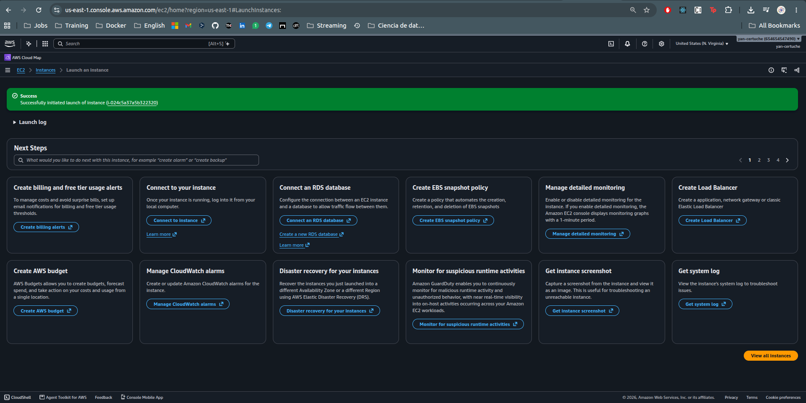
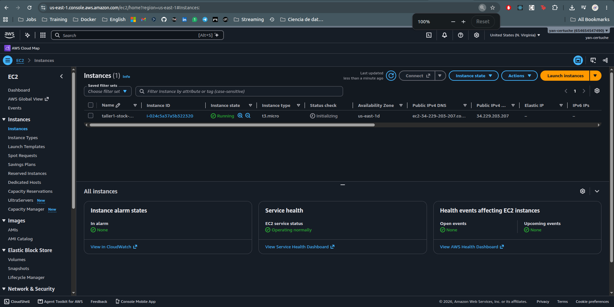
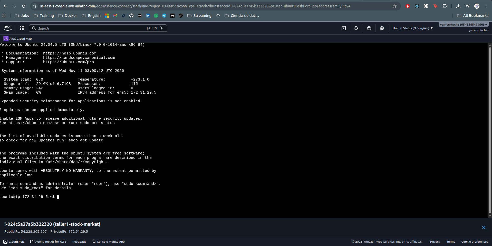

# Evidencias del Taller 1

**Autor:** yancertuche · **Fecha de las pruebas locales:** 10 de noviembre de 2026.

## Repositorios

- Código fuente: [yancertuche/taller1AWS](https://github.com/yancertuche/taller1AWS).
- Versión publicada: [commit dcbc85b](https://github.com/yancertuche/taller1AWS/commit/dcbc85b5b5e0ba7e5a00925ec3e3cc2593035c73).
- Imagen pública: [yancertuche/stock-market:1.0](https://hub.docker.com/r/yancertuche/stock-market).

## Resultados obtenidos

| Verificación | Resultado |
| --- | --- |
| Pruebas en Ubuntu, Python 3.10 | 24 pruebas satisfactorias |
| Pruebas en Docker, Python 3.11 y sin red | 24 pruebas satisfactorias |
| Dependencias | `pip check`: sin incompatibilidades |
| Aplicación contenerizada | `http://localhost:5000`, contenedor saludable |
| Ruta `/health` | HTTP 200 |
| Fecha inválida | HTTP 400 |
| Consulta JSON y tabla HTML con datos reales | HTTP 200 en ambas rutas |
| Publicación en Docker Hub | Etiqueta `1.0` publicada correctamente |
| Acceso público a la imagen | Lectura del manifiesto y `docker pull` sin credenciales satisfactorios |

Consulté **GOOGL** entre el **1 de enero y el 1 de febrero de 2024**, con fecha final exclusiva. Obtuve **21 registros** y un promedio de cierre de **143,84238**. También comprobé la página principal con sus parámetros predeterminados.

## Archivos de soporte

- [Verificación HTTP local](evidencias/local-http.json).
- [Verificación HTTP del contenedor](evidencias/docker-http.json).
- [Verificación HTTP después de actualizar el DNS del contenedor](evidencias/docker-http-dns.json).
- [Registro de pruebas](evidencias/pruebas.txt).
- [Metadatos de la imagen](evidencias/imagen-local.json).
- [Verificación pública de Docker Hub](evidencias/docker-hub.json).
- [Página HTML obtenida del contenedor](evidencias/docker-index.html).
- [Cabeceras de la respuesta HTTP](evidencias/docker-headers.txt).

Los informes HTTP registran consultas reales a Yahoo Finance. Las pruebas automatizadas usan datos controlados para verificar el comportamiento del código.

La imagen se publicó y verificó el **10 de noviembre de 2026**. Su digest es:

```text
sha256:141e42fb573c64bd1cfb1516e67224f529864005acde6aa96b81a42b4a96672c
```

## Despliegue en AWS EC2

El **10 de noviembre de 2026** inicié el lanzamiento de la máquina virtual desde la consola web de AWS.

| Dato | Valor |
| --- | --- |
| Nombre | `taller1-stock-market` |
| Región | Norte de Virginia, `us-east-1` |
| ID de instancia | `i-024c5a37a5b322320` |
| Sistema observado en la terminal | Ubuntu 24.04.5 LTS, x86_64 |
| Tipo de instancia | `t3.micro` |
| Resultado de la consola | `Success`: solicitud de lanzamiento aceptada |
| Estado observado | `Running`, con `3/3 checks passed` |
| Zona de disponibilidad | `us-east-1d` |
| IPv4 pública asignada | `34.229.203.207` |
| DNS público | `ec2-34-229-203-207.compute-1.amazonaws.com` |
| Acceso a Ubuntu | Conexión exitosa desde EC2 Instance Connect con usuario `ubuntu` |





Las siguientes capturas muestran los detalles de la VM y las opciones de conexión. La pantalla de conexión confirma que las tres comprobaciones de estado finalizaron correctamente.

| Captura | Evidencia |
| --- | --- |
| [Resumen de la instancia](evidencias/ec2-resumen.png) | Estado, IP pública, tipo de instancia e IMDSv2 obligatorio |
| [Conexión desde el navegador](evidencias/ec2-conexion-web.png) | EC2 Instance Connect, usuario `ubuntu` y comprobaciones `3/3` |
| [Instrucciones de conexión SSH](evidencias/ec2-conexion-ssh.png) | Nombre de la clave y DNS del servidor |
| [Primer intento de conexión web](evidencias/ec2-error-conexion-web.png) | Error al establecer la conexión SSH |
| [Reglas de acceso para la terminal web](evidencias/ec2-reglas-conexion-web.png) | SSH desde mi IP, HTTP público y SSH desde la lista de prefijos del servicio AWS |
| [Terminal Ubuntu en EC2](evidencias/ec2-terminal-ubuntu.png) | Sesión establecida como `ubuntu@ip-172-31-29-5` |

El primer intento de conexión web devolvió `Failed to connect to your instance`. El grupo de seguridad permitía SSH únicamente desde mi IP. Añadí una regla SSH/TCP 22 para la lista de prefijos de EC2 Instance Connect y conseguí abrir la terminal de Ubuntu desde el navegador.



El siguiente paso es instalar Docker y ejecutar la imagen publicada. Completaré esta evidencia con el informe `evidencias/ec2-http.json` y una captura de la aplicación funcionando desde Internet.
